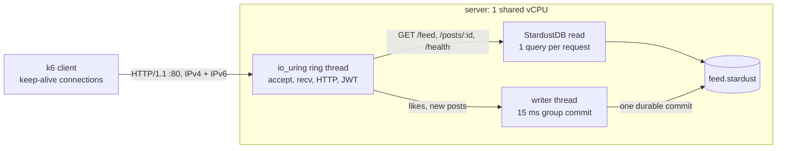

# StardustDB Nanode and Linode 2GB Challenge

**StardustDB** embedded in a raw **Rust io_uring** HTTP server, on Linode's two smallest plans.

The workload is the [$12 server challenge](https://github.com/arjaythedev/twelve-dollar-server-challenge), unmodified: its
API, a seed of 50,000 users, 500,000 posts and 2 million likes, 42 API checks and its k6 load test. A score is the
most users that hold 5 minutes at p95 < 500 ms, p99 < 1 s and < 1% errors.

## Results

All measurements as tables and charts: [`bench/results/latest.html`](bench/results/latest.html). The raw k6 output,
host samples and logs of every run are in [`bench/results/`](bench/results/README.md).

| | Nanode 1 GB ($5/mo) | Linode 2 GB ($12/mo) |
|---|---:|---:|
| **Challenge score** | **8,500 users** | **12,750 users** |
| Throughput · p95 · p99 | 790 req/s · 257 ms · 848 ms | 1,183 req/s · 200 ms · 339 ms |
| Failed requests | 0 of 316,181 | 0 of 473,295 |
| Other scored run | 7,250 | 10,500 |
| Redline peak (30,000 users) | 1,136 req/s | 1,232 req/s |
| **Keep-alive connections held** (5 min, 0 errors) | **150,000** | **375,000** |
| Where it stopped | 175,000 step: out of memory | 400,000 step: out of memory at 394,043 |
| Disk writes during the score, avg / peak | 13.7 / 18.5 MiB/s | 16.1 / 20.9 MiB/s |

- **The score is CPU-bound.** Each read is one StardustDB query of ~0.8 ms, so one shared vCPU tops out at
  1,000–1,200 req/s.
- **Connections are memory-bound.** Each costs ~3.4 KiB of kernel memory; the server process stays near 50 MB.
- No caching across requests, and every write is durable before its reply, as the challenge requires.



## Versions

| | |
|---|---|
| **StardustDB** | **`alpha-2610112101`** (revision `9b9aee3`, built 2026-10-11, ABI 1), linked statically |
| Servers | Linode `g6-nanode-1` and `g6-standard-1`, us-central, 1 shared vCPU (AMD EPYC 7713; one session on a 7642) |
| OS | Ubuntu 24.04, Linux 6.8.0-134, tuned profile ([`tune-host.sh`](deploy/host/tune-host.sh)), no swap |
| Server | Rust 1.94.0 (edition 2024), crates pinned in [`Cargo.lock`](server/Cargo.lock) |
| Load | k6 v2.3.0 (go1.26.8) on a Linode `g6-dedicated-16` in the same region |
| Challenge | commit [`026bdb6`](https://github.com/arjaythedev/twelve-dollar-server-challenge/tree/026bdb68d94d0d932bb5981321ad82c70618d752), SHA-256 checked by [`upstream.sh`](bench/upstream.sh) |
| Infrastructure | OpenTofu 1.13.1, Linode provider 4.7.0 |
| Runs | 2026-10-16 to 2026-10-18 |

## Reproduce

StardustDB is commercial and not included. You need its release bundles (one for your machine, one for linux
x86_64) and a license in `~/.config/stardustdb/stardust.license`. You also need Rust, Node 18+, Python 3, `zstd`,
`jq`, `curl`, `openssl`, `minisign`, OpenTofu, and a Linode API token with Linodes, Firewalls and IPs read/write.

```bash
STARDUST_MINISIGN_KEY=... bash deploy/bundle.sh <stardust-release>.zip        # once per bundle -> third_party/
echo "LINODE_API_TOKEN=..." > .env

make seed && make check                                               # seed database, 42 API checks locally
make up CLIENT=g6-dedicated-16 && make redline && make connections    # Nanode 1 GB
make up TYPE=g6-standard-1 && make redline && make connections        # Linode 2 GB
make down                                                             # destroy the servers and firewalls
```

Each session writes `bench/results/<time>-<plan>-<profile>/` with k6's raw output and a `report.html`, and records
the deployed StardustDB version in its `server.txt`. To compare versions, run the same steps with the new bundle in
`third_party/`, then `make report RESULTS="bench/results/<old> bench/results/<new>"`. For the
connection ceiling, run one step per freshly booted server (`make connections CONNS=300000`): a second ramp in the
same boot fails early.

## Layout

| Path | What |
|---|---|
| `server/` | The Rust server: io_uring network layer (`uring.rs`), StardustDB reads (`db.rs`), group-commit writer (`writer.rs`), seed importer |
| `seed/` | Seed build (`make-seed.sh`) and its size and RAM measurements (`measure.py`) |
| `bench/` | The challenge's files (pinned), local checks, scoring, connection test, charts (`report.py`); `results/` |
| `deploy/` | OpenTofu and deploy scripts for Linode (`linode/`), host tuning and samplers (`host/`) |
| [`DESIGN.md`](DESIGN.md) | How the server works, and its StardustDB usage checked against the Rust reference |

## Credits

- The [$12 server challenge](https://github.com/arjaythedev/twelve-dollar-server-challenge) by arjaythedev and
  contributors (MIT): the API, tests, seed generator, load test and scoring procedure.
- Scooter1337 (MIT): the io_uring network layer and the HTTP, JWT and JSON code, from
  [PR #19](https://github.com/arjaythedev/twelve-dollar-server-challenge/pull/19).

The MIT license of the adapted code is at the top of [`server/src/uring.rs`](server/src/uring.rs). No license has been
chosen yet for the rest of this repository.
