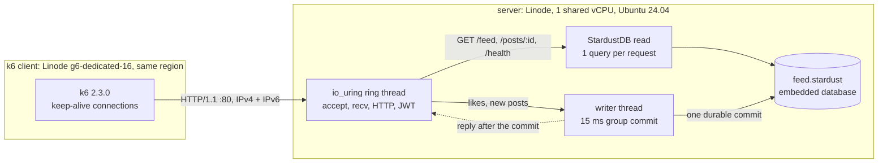

# StardustDB Nanode and Linode 2GB Challenge

**StardustDB** embedded in a raw **Rust io_uring** HTTP server, benchmarked on Linode's smallest boxes.

The workload is the [$12 server challenge](https://github.com/arjaythedev/twelve-dollar-server-challenge):
- five endpoints (the challenge's [`SPEC.md`](https://github.com/arjaythedev/twelve-dollar-server-challenge/blob/026bdb68d94d0d932bb5981321ad82c70618d752/SPEC.md));
- a seed of 50,000 users, 500,000 posts and 2 million likes;
- 42 exact-byte API checks;
- a k6 load test. A run's score is the most virtual users that hold 5 minutes at p95 < 500 ms, p99 < 1 s and < 1% errors.

## Results

Every number below is k6's own output, linked to the raw file. [`bench/results/`](bench/results/README.md) holds every session:
- k6's logs, summary JSON and dashboards;
- the session's console output and its deploy log, with all 42 checks;
- the server's per-second host samples and its own stats;
- the kernel's log when a step ended the server.

IP addresses and the license status are the only things removed.

| | Nanode 1 GB (`g6-nanode-1`, $5/mo) | Linode 2 GB (`g6-standard-1`, $12/mo) |
|---|---|---|
| **Challenge score** (5-minute hold) | **8,500 users**: p95 257.01 ms · p99 848.11 ms · 0 of 316,181 failed · 790 req/s ([k6 log](bench/results/20261017T120045Z-g6-nanode-1-tuned-redline/confirm-8500.log)) | **12,750 users**: p95 200.04 ms · p99 338.85 ms · 0 of 473,295 failed · 1,183 req/s ([k6 log](bench/results/20261016T215520Z-g6-standard-1-tuned-redline/confirm-12750.log)) |
| Other scored runs | 7,250 (2026-10-16) | 10,500 (2026-10-17) |
| **Redline peak** | 1,136 req/s at 30,000 users; no crash | 1,232 req/s at 30,000 users; no crash |
| **Connections held** (5-minute hold) | **150,000**: p95 1.48 ms · 0 errors ([k6 log](bench/results/20261017T125625Z-g6-nanode-1-tuned-connections/conns-150000.log)) | **375,000**: p95 14.09 ms · p99 114.4 ms · 0 errors ([k6 log](bench/results/20261018T221151Z-g6-standard-1-tuned-connections/conns-375000.log)) |
| Where it stopped | 175,000: out of memory | 400,000: reached 394,043, then out of memory ([kernel log](bench/results/20261018T222802Z-g6-standard-1-tuned-connections/dmesg-end.txt)) |

Every box has one shared vCPU. Scores vary between boxes of the same plan by up to ~20%; the table keeps every scored
run. All runs used the tuned host profile, with k6 on a dedicated Linode in the same region (us-central). As the
challenge requires:
- every request reads StardustDB while it is being served, with no caching across requests;
- every write is durable before its reply.

## What was happening



**The score is bound by CPU.** One thread serves every connection, and each read is one StardustDB query with a
flat cost: 0.73–0.85 ms on the Linode 2 GB at every step from 1,000 users to 20,000. So the single vCPU fills at
about 1,000–1,200 req/s, and extra users only wait longer. A challenge user sends ~0.1 req/s, so 65,000 users would
need ~6,900 req/s. Every StardustDB query first zeroes a 4 MiB scratch arena, so one vCPU cannot get near that rate
([`DESIGN.md`](DESIGN.md)).

**Connections are bound by memory.** Holding a connection costs no CPU between requests. It costs ~3.4 KB of kernel
memory (unreclaimable slab), and the server process itself stayed at ~50 MB. On the Linode 2 GB, on a freshly booted
kernel, at a steady ~1,000 StardustDB reads/s:

| Connections | k6 p95 · p99 | Kernel slab | Page cache | What it means |
|---:|---|---:|---:|---|
| 300,000 | 2.76 ms · 10.49 ms | 1,047 MB | 308 MB | plenty left |
| 350,000 | 3.22 ms · 11.37 ms | 1,210 MB | 86 MB | the database's pages are being squeezed out |
| 375,000 | 14.09 ms · 114.4 ms | 1,297 MB | 53 MB | database reads go back to disk; latency rises, still within the limits |
| 400,000 | 19.56 ms · 27.28 s, 38.7% failed | 1,345 MB at 394,043 | 1 MB | disk reads at 212 MB/s, then the kernel's OOM killer ends the server |

The Nanode follows the same curve from ~680 MB available: 150,000 held, out of memory at 175,000.
[`bench/results/README.md`](bench/results/README.md) has every step and how the two boxes compare.

**Where the score came from.** On the Nanode, the score went from a failed first deploy (1,000 users at p95 21.8 s)
to 4,250, 4,750, 7,250 and then 8,500:
- an allocator setting cut kernel time;
- the feed went from 41 queries to 1, and a post from 2 queries to 1;
- writes moved to a group-commit writer with a 15 ms window.

## Storage and seed measurements

Database file length, allocated disk blocks, write traffic and RAM are separate measurements. The
[2026-10-17 observation](bench/results/20261017-storage-observation/README.md) compares the raw TSV inputs,
compressed upload, server seed and running database. Older sessions did not record file sizes, so their
disk-throughput charts cannot establish database growth.

New runs collect:
- `seed/seed-metrics.json` from `make seed`: TSV bytes, rows and hashes; import elapsed time and peak RSS;
  completed database apparent bytes, allocated bytes and hash. Compilation, generation, hashing and compression
  are outside the import timer. This receipt describes that local import, not an earlier server session.
- `storage-snapshots.csv` from `make bench`, `make redline` and `make connections`: the previous run before reset,
  a baseline after the fresh copy starts, and the final run file. No database contents are read by the collector.
- Additional `host.csv` columns every second: file identity, apparent/allocated bytes, filesystem free bytes,
  process identity, cumulative process write/cancelled-write bytes, and process peak RSS.
- `report.html`: session file growth and sampled changes for each k6 run, with separate process write volume.
  Missing baselines or changed file/process identities produce unavailable deltas. Per-run samples must be
  within three seconds of both k6 boundaries; the covered duration is shown. Keep client/server clocks synchronized.

The service creates a sparse copy of the seed. Compare the run with its own starting allocation, not the seed's
allocation. Allocated blocks may include shared extents, and process I/O accounting is not physical-device write
amplification. An end snapshot is a live observation, not a forced flush: the collector never calls `sync`.
Storage growth alone cannot establish how much space is data, indexes, allocator slack or retained history.

The updated sampler is installed at the next benchmark invocation. The collection regression checks run with
`python3 -m unittest discover -s bench -p 'test_*.py'`.

## Reproduce

> **StardustDB is a commercial embedded database and is not included.** You need its release bundles (one for your
> machine, one for linux x86_64) and a license, placed in `~/.config/stardustdb/stardust.license` or `$STARDUST_LICENSE`.

Tools:
- Rust 1.85+, Node 18+, Python 3, `zstd`, `jq`, `curl`, `openssl` and `minisign`;
- OpenTofu (or Terraform);
- a Linode API token with Linodes, Firewalls and IPs read/write (the IPv6 range for the connection test).

```bash
# 1. StardustDB bundles -> third_party/ (git-ignored). The minisign key comes from StardustDB.
export STARDUST_MINISIGN_KEY=...
bash deploy/bundle.sh <stardust-release-for-this-machine>.zip
bash deploy/bundle.sh <stardust-release-linux-amd64>.zip

# 2. Seed database (~80 s, ~8 GB RAM) and the 42 API checks, locally.
make seed && make check

# 3. Nanode 1 GB: deploy the server and a k6 client, score it past the limit, then the connection test.
echo "LINODE_API_TOKEN=..." > .env
make up CLIENT=g6-dedicated-16 && make redline && make connections

# 4. Linode 2 GB: replace the server, score it, then the connection test.
make up TYPE=g6-standard-1 && make redline && make connections

# 5. Destroy the server, the client and the firewalls.
make down
```

Each step's details:
- **`make up`:**
  - provisions Ubuntu 24.04 in us-central behind a firewall that admits only you and the client;
  - uploads the source, the bundle, the zstd seed and the license (over SSH stdin, mode 0600);
  - builds the server on the box with StardustDB linked statically;
  - installs a systemd service with the tuned profile (`deploy/host/`) and turns off swap and background jobs;
  - runs the 42 checks.
- **`make bench`:** follows the challenge's scoring procedure.
- **`make redline`:** the same, then continues past the score to find the peak and the breaking point.
- **`make connections`:** steps up in connections, from 70k by default (`CONNS="..."` sets the steps), and stops at the
  first step that misses a limit. For the ceiling, run one step per freshly booted server, because a second ramp in
  the same session fails early. That means `make connections CONNS=300000`, then reboot the server, run `make up` to
  add the IPv6 addresses back, and run the next step.

Every session writes `bench/results/<time>-<plan>-<profile>/`: a self-contained `report.html` of latency,
throughput, server CPU, memory, network, disk and group commits, plus the raw CSVs and k6's dashboards.

The challenge's own files are not copied here: its seed generator, `load.js`, `test.sh` and golden responses.
`bench/upstream.sh` downloads them from one pinned commit, checks their SHA-256 hashes and runs them unmodified.

## Layout

| Path | What |
|---|---|
| `server/` | The Rust server: the io_uring network layer (`uring.rs`), StardustDB reads (`db.rs`), the group-commit writer (`writer.rs`), stats, and the seed importer (`src/bin/import.rs`) |
| `seed/` | `make-seed.sh` (the challenge's generator → `feed.stardust`, `tokens.json`), `measure.py` (`seed-metrics.json`: import time, RAM and file sizes) |
| `bench/` | `upstream.sh` (the challenge's files, pinned), `check.sh` (local checks), `score.sh` (scoring, redline, connections), `connections.js`, `report.py` (charts), `test_storage.py` (storage-accounting checks) |
| `bench/results/` | Every published session, raw, with an index ([`README.md`](bench/results/README.md)) |
| `deploy/linode/` | `main.tf` (OpenTofu), `up.sh` (provision, deploy, client, `--down`), `bench.sh` (runs and report) |
| `deploy/host/` | `spinup.sh` (deploy to any Ubuntu box over SSH), `tune-host.sh` (tuned profile, background jobs), the systemd unit, `sample-host.sh` and `storage.sh` (per-second host and file samples) |
| [`DESIGN.md`](DESIGN.md) | How the server works (io_uring, reads, group commit) and the StardustDB data model, with measurements |

## Credits and license

- The challenge by arjaythedev and contributors (MIT) provides the API, test suite, seed generator, load test and
  scoring procedure: the [$12 server challenge](https://github.com/arjaythedev/twelve-dollar-server-challenge).
- Scooter1337 (MIT) wrote the io_uring network layer and the HTTP, JWT and JSON code, in
  [PR #19](https://github.com/arjaythedev/twelve-dollar-server-challenge/pull/19).

The MIT license of the adapted code is at the top of [`server/src/uring.rs`](server/src/uring.rs). The challenge's own
files are downloaded at run time, not copied. No license has been chosen yet for the rest of this repository.
